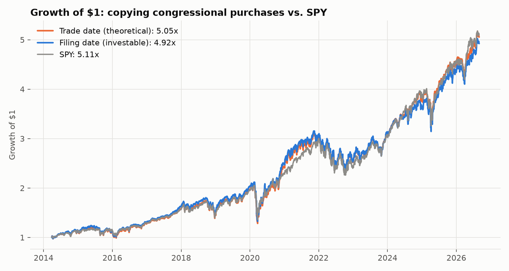
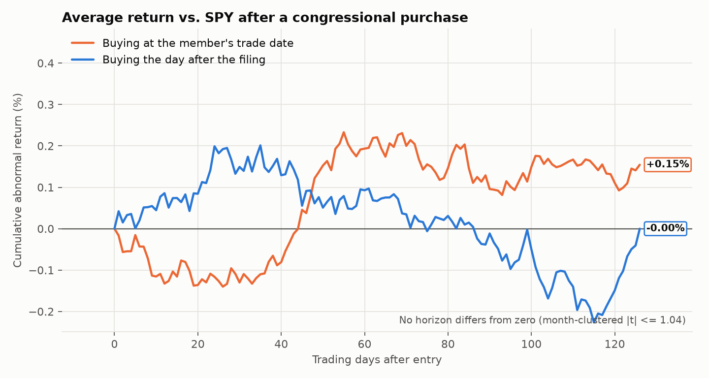
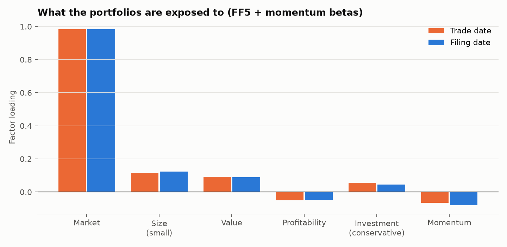
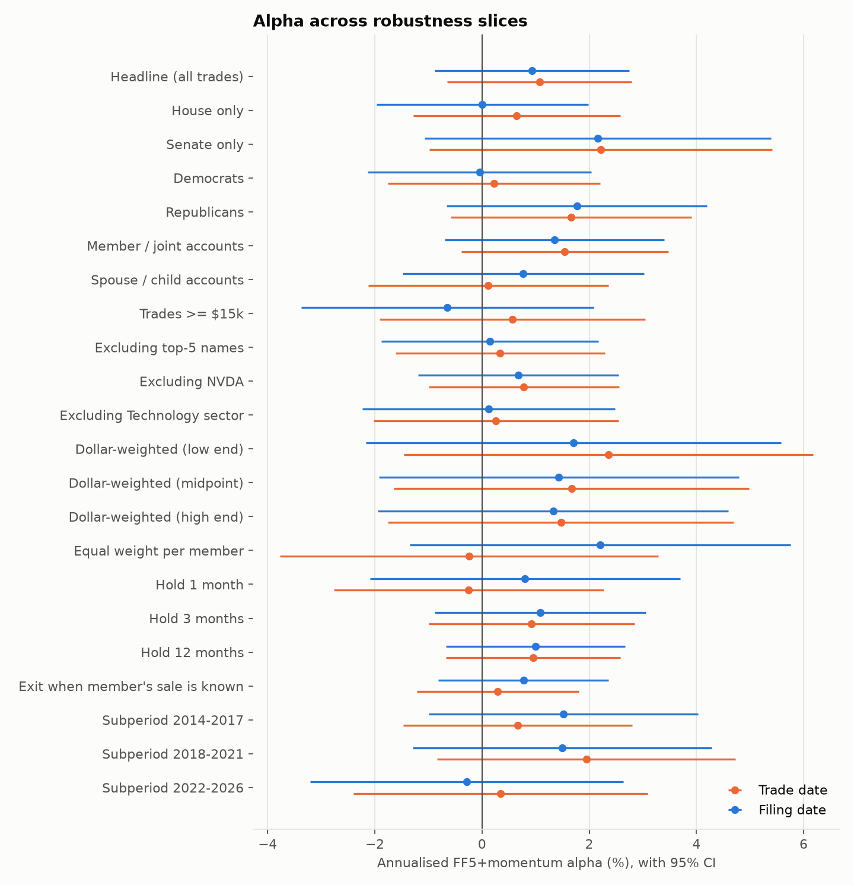

# Can you profit by copying Congress's stock trades?

**Live tracker: [congress-trades-roan.vercel.app](https://congress-trades-roan.vercel.app)**, with every
member's record vs. the market, their trades, and the full study.

**Short answer: no.** Members of Congress must disclose their stock trades within
45 days. This repo builds the full dataset from the official House and Senate
filings: **43,496 common-stock trades by 289 members, 2014–2026**. It then tests
whether copying those trades beats the market.

| Portfolio (Mar 2014 – Aug 2026) | Ann. return | Sharpe | Max DD | FF5+Mom alpha | t-stat |
|---|---|---|---|---|---|
| Buy on the **trade date** (theoretical: what members earned) | 14.0% | 0.70 | −37.4% | +1.1%/yr | 1.22 |
| Buy the day after the **filing** (investable: what you could earn) | 13.7% | 0.69 | −37.4% | +0.9%/yr | 1.00 |
| Same, **after trading costs** (10 bps per dollar traded, 8.4× turnover/yr) | 12.8% | 0.64 | −37.5% | +0.1%/yr | 0.10 |
| SPY | 14.1% | 0.74 | −33.7% | — | — |

1. **Do congressional trades beat the market on the trade date?** No. Members'
   purchases earn a factor-adjusted alpha of +1.1%/yr (t = 1.2), which is
   indistinguishable from zero. After six months, the average purchase is
   −0.04% against SPY (t = −0.1).
2. **Does the edge survive the disclosure delay?** There is no edge to lose. The
   trade-date minus filing-date return spread has an alpha of +0.15%/yr
   (t = 0.42, 95% CI −0.6% to +0.9%).
3. **Real alpha, or factor exposure?** The portfolios hold ~340 names and track
   the market (beta 0.98, R² 0.97), with mild small-cap and value tilts. The
   small positive point estimate comes from mega-cap tech. Drop the top five
   names (NVDA, AAPL, MSFT, AMZN, META) and alpha falls from 0.9% to 0.1%/yr.

The investable 95% confidence interval is **−0.9% to +2.8% per year** before
costs: any copy-trading edge is at most a few percent and plausibly zero. Paying
to trade (the portfolio turns over 8.4× a year) takes 0.8%/yr off that, leaving an
after-cost alpha of +0.1%. **0 of 42** robustness slices (chamber, party, account
owner, trade size, weighting, holding period, subperiod, concentration) are
significant at 5%, even before multiple-testing correction.

The two-page write-up is in [reports/memo.md](reports/memo.md).






## Method

**Data.** Every Periodic Transaction Report (PTR) from 2014 to Sep 2026:
- **Senate:** scraped from the Senate eFD search, where electronic filings are HTML tables.
- **House:** parsed from the House Clerk's PDFs. Older House PDFs garble letter
  case ("aXP", "[sT]"), wrap amounts across lines, and only carry asset-type tags
  from about 2019. The parser handles all of these, with tests.
- **Prices:** daily total-return prices from yfinance.
- **Factors:** daily Fama-French 5 factors plus momentum from the Ken French Data Library.
- **Party:** from [unitedstates/congress-legislators](https://github.com/unitedstates/congress-legislators),
  matched to the term active on the trade date.

**Cleaning.** Each step is counted in
[`data/processed/cleaning_waterfall.csv`](data/processed/cleaning_waterfall.csv):

| Step | Rows left |
|---|---|
| Raw transaction rows | 72,069 |
| Drop exchanges; options, bonds, funds, other non-stock; no ticker | 54,942 |
| Drop impossible dates (filed before trade, or more than 3 years late) | 54,555 |
| Drop duplicate rows from amended filings (keep the earliest disclosure) | 50,510 |
| Drop tickers with no yfinance price (delisted → survivorship) | 44,865 |
| Drop ETFs/funds (yfinance instrument type), no price on trade date | 43,882 |
| Drop tickers whose yfinance history is corrupt (negative adjusted closes), recycled tickers | **43,496** |

**Portfolios.** Calendar-time portfolios. Each disclosed purchase opens a position.
- **Hold:** 126 trading days (~6 months).
- **Weighting:** equal-weighted across open positions, rebalanced daily.
- **Trade-date portfolio:** enters at the close of the transaction date.
- **Filing-date portfolio:** enters at the close of the trading day *after* the
  filing date. Filings can be posted after the close, so entering on the filing
  date itself would be look-ahead.
- **Window:** starts once both portfolios hold at least 20 names (28 Mar 2014) and
  ends when the factor data ends (31 Aug 2026).

**Inference.**
- **Factor regressions:** daily excess returns on CAPM, FF3, FF5 and FF5+Mom,
  with Newey-West (10-lag) standard errors.
- **Event study:** returns over SPY. Events in the same month share market
  shocks, so t-stats treat each calendar month as one observation, with
  Newey-West errors across months because six-month windows overlap.
- **Trading costs:** 10 bps per dollar traded, charged on the daily rebalancing
  the equal-weight rule implies (`analysis.turnover`).
- **Robustness:** Holm-adjusted p-values across all 21 slices per portfolio.

## Pitfalls, and how they're handled

| Pitfall | Treatment |
|---|---|
| **Look-ahead bias** | The investable portfolio uses only the filing date, entering the day after. A disclosed *sale* closes a position only after that sale's filing date. Both are enforced by unit tests (`test_filing_date_portfolio_has_no_lookahead`, `test_exit_on_sale_uses_only_known_information`). |
| **Survivorship bias** | 5,645 cleaned trades (11.2%) have no yfinance history, mostly acquired companies (Twitter, Activision, Celgene, Allergan, Red Hat) and rolled-up MLPs. 28 ticker changes with continuous history (e.g. SQ→XYZ, UTX→RTX, MMC→MRSH) were mapped by hand. Acquisition targets often rise on announcement, so the missing trades probably bias results slightly *against* the copier. |
| **Noisy amounts** | Amounts are disclosed as ranges. Dollar-weighted portfolios using the low end, midpoint and high end give alphas of 1.7%, 1.4% and 1.3% (all t < 0.9). |
| **Multiple testing** | 42 slice tests. At a 5% level, two false positives would be expected by chance; none occur. Holm adjustment is reported anyway. |
| **Coverage** | Scanned paper filings (26% of House PTRs and 17% of Senate PTRs, concentrated in early years) are image-only and excluded. |
| **Recycled tickers** | Each filed asset name is compared with the priced company's name. 353 mismatches are dropped. |
| **Bad price data** | Yahoo's history for a few OTC ADRs has negative adjusted closes (those tickers are dropped), sub-penny shells print ±100% "returns" on one tick (prices under $0.05 are blanked), and a mis-keyed print that reverses the next day, or a 10× break where two series were glued together, is blanked (`prices.load_returns`). Real crashes are kept. An earlier version of this study reported that members' *sales* trailed SPY by 2.6%/yr; that came entirely from these corrupt series. |

## Validation

- **Automated cross-check.** For 2014–2020 Senate stock trades, the independent
  [Senate Stock Watcher](https://github.com/timothycarambat/senate-stock-watcher-data)
  dataset was compared with this repo's parse:
  - 97.8% of its trades appear here.
  - 89.2% of this repo's trades appear there. The gap is mostly early-2014 filings
    that predate eFD's asset-type column, which that dataset leaves untyped.
  - Mismatches are listed in `data/processed/crosscheck_only_*.csv`.
- **Manual spot-check.** [`data/processed/spot_check_50.csv`](data/processed/spot_check_50.csv)
  is a stratified sample of 50 trades (25 House, 25 Senate, every year), each
  linked to its original filing, for line-by-line verification.

## Reproduce

```bash
python -m venv .venv && .venv/Scripts/activate      # or source .venv/bin/activate
pip install -e . pandas numpy statsmodels yfinance matplotlib pytest requests beautifulsoup4 lxml pdfplumber pyarrow
python -m congress.pipeline        # scrape + clean + price + study + figures (≈2h first run, cached after)
pytest
```

Raw filings and price caches (`data/raw`, `data/interim`) are git-ignored and
re-downloadable. The cleaned trades and every results table are committed.

## Website

`web/` is a Vue 3 + Vite site built on [frappe-ui](https://github.com/frappe/frappe-ui), the component
library behind [Frappe Builder](https://github.com/frappe/builder). It is fully static, reading JSON exported
by `python -m congress.site_data`, and is hosted on Vercel.

- **Overview**: the headline result, growth chart, best and worst members, most-bought stocks, latest filings.
- **Members**: sortable, filterable leaderboard; every member page has two verdicts (their timing vs. copying
  them), a copy-odds and position-sizing calculator, a chart vs. SPY, and every trade linked to its filing.
- **Latest trades** and **Options & more**: recent disclosures and the 13,756 non-stock trades (options with
  parsed call/put, strike and expiry; bonds; funds and ETFs; crypto; private holdings), built by
  `python -m congress.other_assets`. Shown as disclosed, not analyzed.
- **Your picks** (`/picks`):
  a Buy / Watch / Don't buy call for every trade disclosed in the last 30 days, with a calibrated confidence,
  recent headlines and a dollar amount sized to the viewer's risk settings. Built by `python -m congress.recs`,
  which fits a logistic model on pre-2020 trades and tests it on a frozen 2021–2025 window; it only ever labels
  a trade "Buy" if the top-rated group beat SPY in that window with t >= 2 (month-clustered, Newey-West across
  months because six-month outcomes overlap). The window is frozen on purpose: re-testing the gate every day as
  data arrives would be repeated looks at one hypothesis. Right now it doesn't pass, so the best calls are
  "Watch". The confidence shown is the realized out-of-sample hit rate of the score's calibration quintile.
  **Options** get their own tab: for each option a member bought, the chance it finishes in the money (lognormal,
  from today's stock price, the strike, days left and the past year's volatility). Checked against 256 expired
  congressional option buys: predicted 53%, realized 56%. Under 25% or under 14 days left is "Don't buy"; the rest
  are "Watch", never "Buy", since option prices (the premium you'd pay) aren't available. The picks JSON changes daily, so it is git-ignored and deployed straight to the site rather than committed.

- **Agent desk** (`/agents`): [TradingAgents](https://github.com/TauricResearch/TradingAgents)
  (analysts, a bull/bear debate, a trader and a risk manager built on LangGraph) reviews new congressional
  buys, and its five-tier rating is traded with **$1,000 of fake money**, next to $1,000 in SPY and $1,000
  following the statistical picks. The page shows the equity curves, open and closed positions, each call's
  full reasoning, and the month's LLM spend. See below.

Search any member from any page with `/`. Light and dark mode, phone-width layouts.

```bash
python -m congress.site_data          # refresh web/public/data/ from the study outputs
python -m congress.recs               # rebuild the picks (web/public/picks/, git-ignored)
cd web && npm install && npm run dev  # local preview
npx vercel deploy --prod              # from web/
```

### Agent desk

`congress.agents` runs TradingAgents (pinned to a reviewed commit) on the best new disclosed buys each day, and
`congress.paper` replays the decisions as a paper account:

- **Rules:** Buy/Overweight puts $100 into the stock (max 10 positions, one per stock, no leverage or shorting);
  Sell/Underweight closes it; Hold does nothing; positions close after 20 trading days. Every fill is at the
  close of the first trading day *after* the analysis date, with 0.1% slippage, so a call never trades on
  prices it could already see. The account is recomputed from the decision list each time, never stored.
- **Cost control ($5/month):** every LLM call is metered by `BudgetGuard` (tokens x list price x 1.25 safety margin).
  A run aborts the moment it passes its per-run ceiling (tested through a real parallel LangGraph), no run starts
  unless it fits under 95% of the monthly cap, and spend is paced evenly across the month. A failure before any
  model call (e.g. an account with no credits) is logged and stops the day's loop; it is never recorded as a decision.
  Keep prepaid credit on the OpenAI account small as the real backstop.
- **State:** results are written to `web/public/picks/agents.json` (git-ignored, deployed with the site).
  The running state (decisions, ledger) lives encrypted with Fernet on an `agents-state` branch, so it is durable
  and versioned but unreadable without `AGENTS_STATE_KEY`.
- **Honesty:** a handful of trades a month is mostly luck for a long time. The page says so, keeps every call as
  made, and never re-runs one to change an answer.

### Daily update

`.github/workflows/daily.yml` runs `python -m congress.daily` every morning before the US open: new House and
Senate filings, fresh prices for recently traded tickers, non-stock trades, site data and picks, then a Vercel
deploy. Filing and price caches
persist in the Actions cache; the first run seeds them from the `data-seed` release asset instead of
re-scraping 2014–2026. The study itself (regressions, robustness, figures) re-runs when the Ken French factor
files publish a new month. Secrets: `VERCEL_TOKEN`, `VERCEL_ORG_ID`, `VERCEL_PROJECT_ID`, `OPENAI_API_KEY`,
`AGENTS_STATE_KEY`, and optionally `FRED_API_KEY` (macro data for TradingAgents; skipped when absent).
Vercel's own git-triggered builds are switched off (`vercel.json`), since the picks and agent data never go through git.

## Layout

```
src/congress/
  scrape_senate.py   Senate eFD search + HTML PTR parser
  scrape_house.py    House Clerk index + PDF PTR parser
  clean.py           stock filter, amounts, dates, party match, amendment de-dup
  prices.py          yfinance prices, ticker-rename map, rate-limit handling
  dataset.py         price-side filters (delisted, ETFs, recycled tickers)
  factors.py         Ken French daily FF5 + momentum
  portfolio.py       calendar-time portfolio engine (trade-date / filing-date rules)
  metrics.py         return, Sharpe, drawdown, tracking error, IR
  analysis.py        factor regressions, event study, concentration, Holm
  study.py           runs everything -> reports/results/
  plots.py           figures -> reports/figures/
  validate.py        Senate cross-check, 50-trade spot-check sample
  site_data.py       per-member stats + JSON export for the website
  other_assets.py    options / bonds / funds / crypto trades (listed, not analyzed)
  odds.py            copy hit rates, luck-adjusted member odds, bad-case percentiles
  recs.py            Buy/Watch/Don't-buy model, out-of-sample backtest, private picks JSON
  daily.py           incremental daily update used by the GitHub Action
  agents.py          TradingAgents runner, budget guard, candidate selection, private export
  paper.py           the $1,000 paper-account simulator (fills, exits, equity curves)
  secure_state.py    Fernet encrypt/decrypt for the agent-desk state
tests/               parser, portfolio-timing and statistics tests
```
